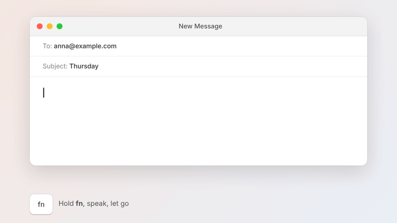
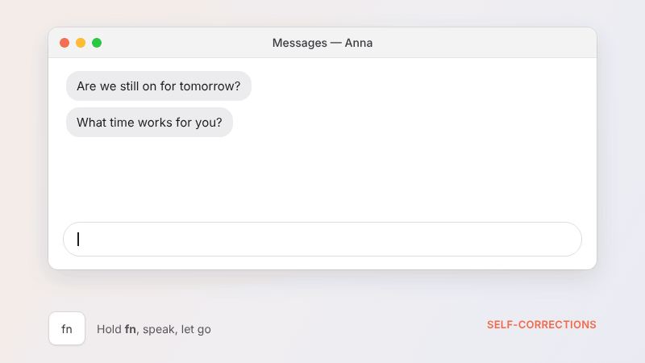
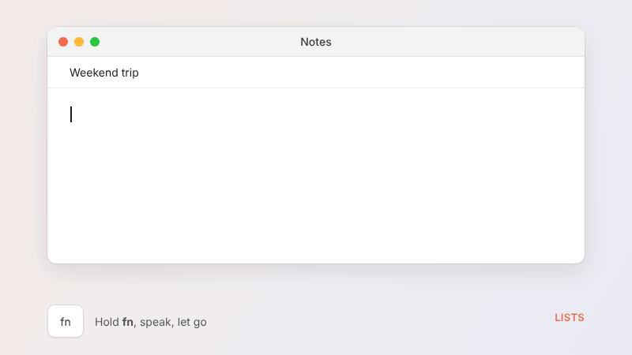
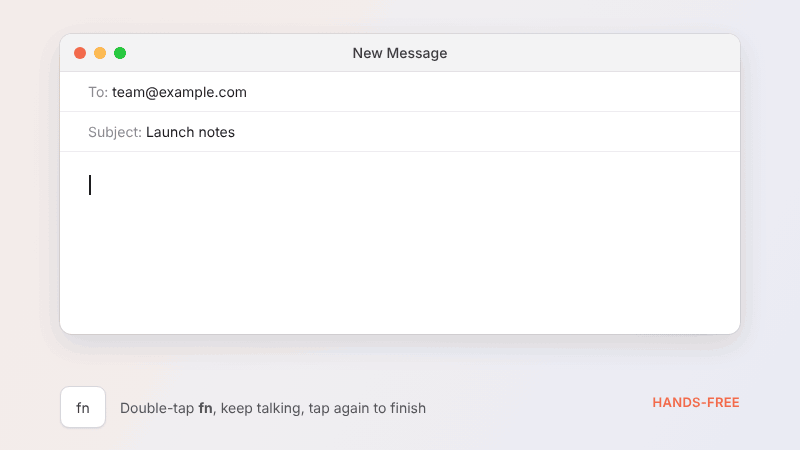
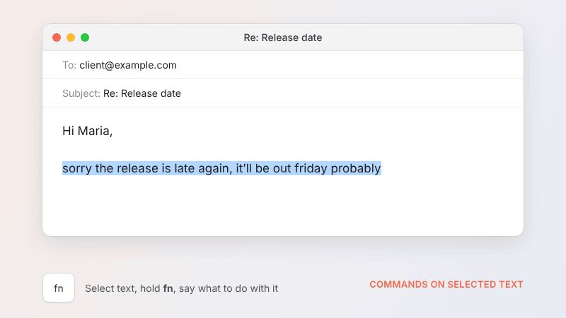
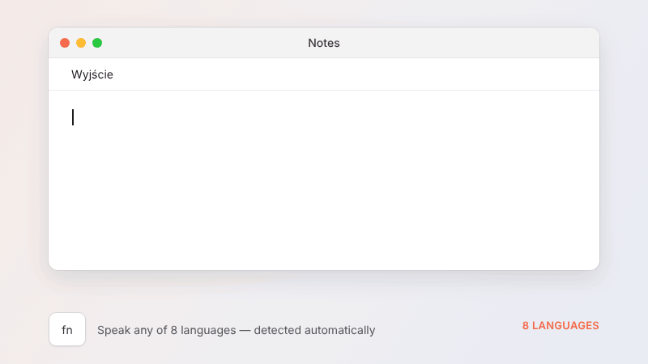
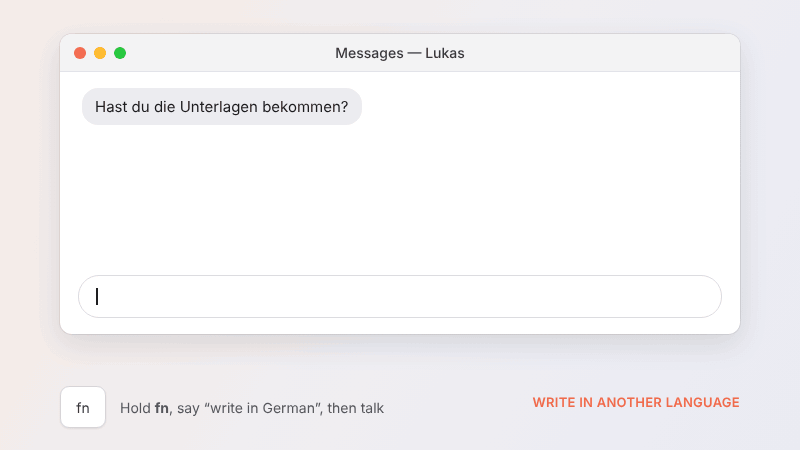
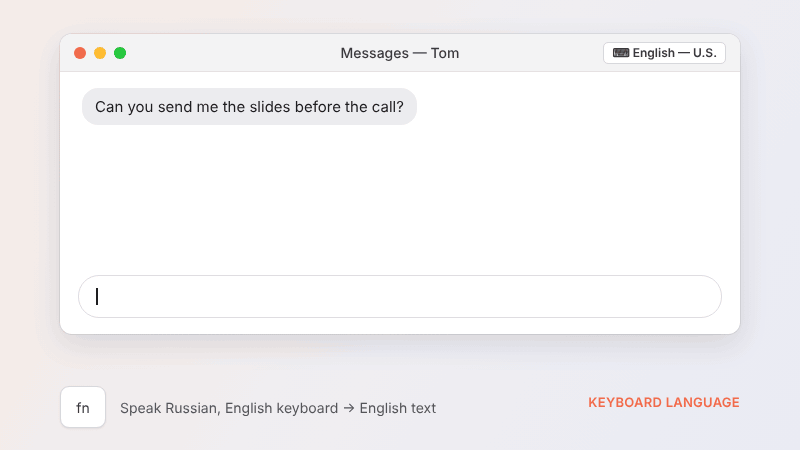
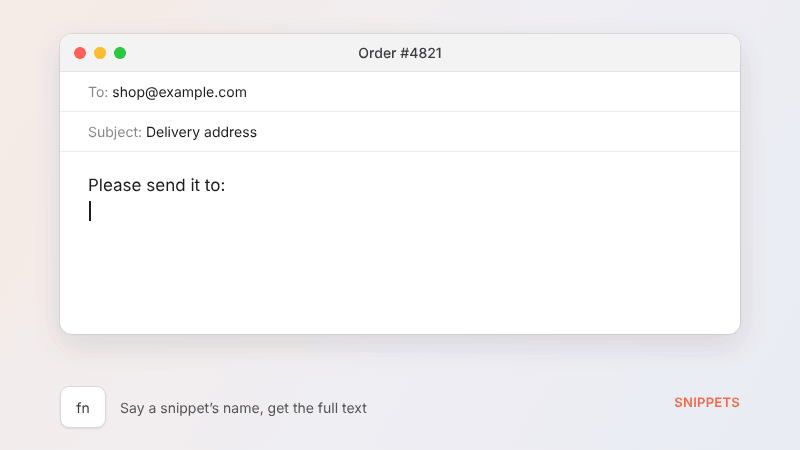

# Mowa

Free, open-source voice dictation for macOS. Hold a key, speak, let go — clean,
punctuated text appears wherever your cursor is. Everything runs on your Mac:
no account, no cloud, nothing you say ever leaves the computer.

*Mowa* is Polish for "speech".

<p align="center"></p>

## Features

### Works in every app
Hold the dictation key (default **fn / 🌐**), talk, release. Clean text is typed at the cursor — mail, chat, notes, browser, anywhere.

### Self-corrections and filler words
Removes "um"s and applies what you meant: "at five, no, six" → "at 6". Fixes punctuation and capitals.

<p align="center"></p>

### Lists
Say the items; Mowa lays them out as a list.

<p align="center"></p>

### Hands-free
Double-tap the key and keep talking; tap again (or click ■) to finish. **Esc** cancels.

<p align="center"></p>

### Commands on selected text
Select text, hold the dictation key and say what to do: "make this more formal", "translate to German", "shorten this".

<p align="center"></p>

### 8 languages
English, Polish, Russian, Spanish, German, French, Portuguese (Brazil), Italian — detected automatically among the languages you tick. The interface is localized in all eight.

<p align="center"></p>

### Write in another language
Say "write in German" (in any of the 8 languages) and the rest is typed in German.

<p align="center"></p>

### Type in your keyboard's language
Turn on **Settings → General → Write in my keyboard's language**: speak any of the 8 languages and the text is typed in the language of your current keyboard layout — speak Russian with an English layout, get English.

<p align="center"></p>

### Snippets
Say a snippet's name ("my address"), get the full text.

<p align="center"></p>

### And more
- **One cleanup model, your choice** — pick from fastest to most accurate (only models your Mac has the memory for are listed), use any MLX model or a model folder on your Mac, or point Mowa at your own OpenAI-compatible server (Ollama, LM Studio, llama.cpp, vLLM).
- **Adapts to the app** — choose a writing style per kind of app (formal, casual, very casual, excited); terminals and editors keep commands and casing intact.
- **Vocabulary** — names and jargon spelled your way (also used to bias recognition), plus fixes for words the recognizer mishears.
- **Noise reduction** (always on) — noisy recordings (fan, street, café) are cleaned with [RNNoise](https://github.com/xiph/rnnoise) before recognition; quiet ones are left untouched.
- **Ignore other people's voices** (opt-in) — read a short text aloud (onboarding or Settings → General → My voice) and Mowa keeps a voiceprint — up to two recordings per language with two different microphones (for example the Mac's and headphones; it records with whichever microphone is on), in any of Mowa's 8 languages; a piece of speech counts as yours if it matches any of them ([WeSpeaker](https://github.com/wenet-e2e/wespeaker) ResNet34, Core ML, bundled). Speech pieces that don't match it are cut before speech recognition hears them. Works when people take turns, not when they talk over each other.
- **History** — searchable, stored locally, can be turned off.

## Models

| Role | Default | Size | Notes |
|---|---|---|---|
| Speech recognition | NVIDIA Parakeet TDT 0.6B v3 (FluidAudio, Core ML) | 480 MB | Apple silicon default — about a third faster than Whisper at the same accuracy in Mowa's eval |
| Speech safety net | Whisper Large v3 Turbo (WhisperKit, Core ML) | 632 MB | Rechecks words Parakeet is unsure of, and Russian; the default on Intel Macs |
| Cleanup | Picked by memory: Qwen3 4B Instruct 2507 (8 GB Macs), Qwen3 8B (16 GB+) — MLX, 4-bit | 2.3 / 4.6 GB | Also: Qwen3 1.7B (fastest) and Qwen3 30B-A3B Instruct 2507 (32 GB+, 17 GB) — the most accurate in all 8 languages and about as fast as the 4B in `scripts/compare-models.sh`, never picked automatically. Gemma 3 and Bielik were tested and not adopted |

Settings only lists models your Mac has the memory for. Any MLX model from Hugging Face can be used instead (Settings → Models).

On **Intel Macs** the same Qwen3 models run as GGUF files (Q4_K_M, from unsloth) with [llama.cpp](https://github.com/ggml-org/llama.cpp), on the CPU (ggml's Metal backend times out on AMD Radeon GPUs). Speech recognition uses [whisper.cpp](https://github.com/ggml-org/whisper.cpp) with the same Whisper models (ggml files) — WhisperKit crashes on x86_64. Defaults there: Whisper Small + Qwen3 1.7B (larger models can be chosen in Settings). Any local `.gguf` (cleanup) or `ggml-….bin` (speech) file can be used instead.
Models are downloaded once from Hugging Face into `~/Library/Application Support/Mowa/Models`; after that Mowa works fully offline.

## Requirements

- macOS 14 Sonoma or newer — Apple silicon (fastest) or Intel (2018 and later Macs that run Sonoma)
- 8 GB RAM minimum, 16 GB+ recommended

## Install

Download the latest version from [mowa.unomage.com](https://mowa.unomage.com), drag Mowa to Applications, open it and follow the setup (microphone + Accessibility permission, model download).

If the emoji picker opens when you press fn, set **System Settings → Keyboard → "Press 🌐 key to" → "Do Nothing"**, or choose another dictation key in Mowa's settings.

## Build from source

Needs Xcode 26 or newer.

```sh
bash scripts/build.sh                # → build/Mowa.app (Apple silicon only, quickest)
bash scripts/build.sh --universal    # Apple silicon + Intel in one app (releases use this)
bash scripts/build.sh --install      # also copies to /Applications and launches
bash scripts/build.sh --test         # MowaCore unit tests
INTEL=1 bash scripts/selftest.sh     # pipeline self-test of the Intel half under Rosetta
bash scripts/compare-models.sh      # cleanup models side by side on the same clips (build/compare.txt)
```

`xcodebuild` is used instead of `swift build` because SwiftPM on the command line cannot compile MLX's Metal shaders.
The first build downloads the Swift package dependencies (WhisperKit, MLX, swift-transformers). `--universal` also builds llama.cpp and whisper.cpp for x86_64 with AVX2 (`scripts/build-ggml-intel.sh`, once, ~5–10 min, needs `brew install cmake`) — the official prebuilt xcframeworks' x86_64 code is SSE2-only and several times slower.

The Intel half is built from the same `Sources/` with `Package.intel.swift` (llama.cpp instead of MLX, whisper.cpp instead of WhisperKit) into `build/intel-pkg/`, then joined with the arm64 binary by `lipo`. To try it on an Apple silicon Mac: Finder → Mowa → Get Info → "Open using Rosetta".

## Project layout

```
Sources/MowaCore/   Pure logic, unit-tested: prompts, model routing, rule-based cleanup,
                    hallucination filter, snippets, vocabulary, language resolution
Sources/CRNNoise/   RNNoise 0.2 (C, BSD), vendored with its model weights
Sources/Mowa/       The app
  App/              Entry point, menu bar, dictation pipeline, update check
  Audio/            Microphone capture (16 kHz mono), input-device list, noise reduction,
                    speaker embeddings / voiceprint (voice filter)
  Hotkey/           Global dictation-key monitor
  Transcription/    WhisperKit wrapper
  Cleanup/          Model engines (MLX on Apple silicon, llama.cpp on Intel) and cleanup service
  Insertion/        Accessibility focus info and paste-based text insertion
  Models/           Download/delete state for all models
  Storage/          Settings, history, vocabulary, snippets, log
  UI/               Overlay, settings, onboarding, history
Support/            Info.plist, entitlements, icon, localizations (8 languages),
                    SpeakerEmbedding.mlpackage (compiled into the app by build.sh)
scripts/            build.sh
```

## Privacy

- Audio is recorded only while the dictation key is held (or hands-free mode is on), processed in memory, and discarded.
- Transcripts are kept in a local history file only if history is on (`~/Library/Application Support/Mowa/history.json`).
- The voiceprint (if you set one up) is 256 numbers per recording in `~/Library/Application Support/Mowa/voiceprint.json`; the enrollment recording itself isn't kept. Settings → General → My voice → Forget my voice deletes it.
- The only network requests are model downloads from Hugging Face and an optional update check against mowa.unomage.com (no analytics, no tracking).

## Credits

[WhisperKit](https://github.com/argmaxinc/argmax-oss-swift) by Argmax · [MLX Swift](https://github.com/ml-explore/mlx-swift) and [MLX Swift LM](https://github.com/ml-explore/mlx-swift-lm) by Apple · [swift-transformers](https://github.com/huggingface/swift-transformers) by Hugging Face · OpenAI Whisper · Qwen by Alibaba · [RNNoise](https://github.com/xiph/rnnoise) by Xiph.Org/Mozilla · [WeSpeaker](https://github.com/wenet-e2e/wespeaker) speaker model (VoxCeleb, CC BY 4.0).

## License

MIT
